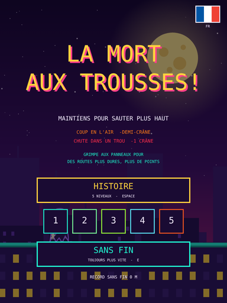
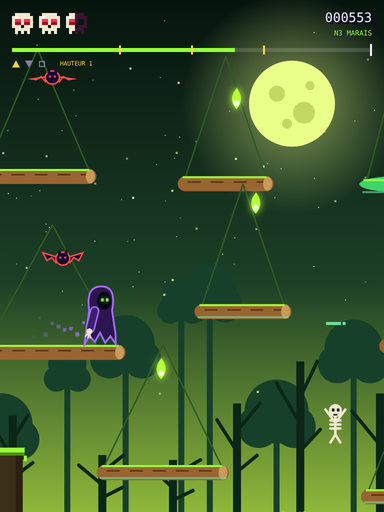
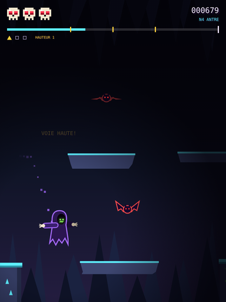
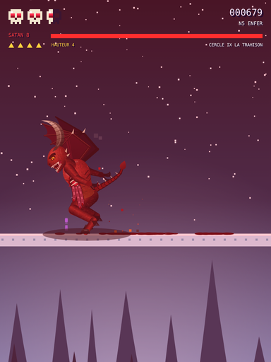

# La Mort aux Trousses!

*Reaper Run* in English. A one-button retro runner in a single HTML file.

You are a small hooded reaper. The world scrolls past and you stay in place. All you can do is jump: tap for a hop, hold for a higher one. Climb branching routes for more points, survive five themed levels, and finish with a duel against Satan. There's also an endless mode that just keeps getting faster.

The game runs in French by default. A flag in the top-right corner of the main menu switches to English.

<p align="center">
  
  
  
  
</p>

## Running it

The whole game is one file, [`index.html`](index.html). It needs no build step, no install and no server.

- **On a computer:** download `index.html` and open it in any modern browser (Chrome, Firefox, Safari, Edge).
- **On a phone:** the game is made for portrait phones. Phones are awkward about opening local HTML files, so the easiest way is to host the file somewhere and open the link. GitHub Pages works: in this repo's **Settings → Pages**, publish from the `main` branch, then open `https://<user>.github.io/mort-aux-trousses/`. Add it to your home screen for a full-screen feel.
- **Local server (optional):** `python3 -m http.server` in this folder, then open `http://localhost:8000`. This is only useful for testing on a phone over your local network.

The pixel font loads from Google Fonts. Offline, the game still runs with a fallback monospace font.

Best scores and your language choice are saved in your browser's local storage. Nothing leaves your device.

## How to play

### Controls

| Action | Phone | Keyboard |
|---|---|---|
| Jump (hold for higher) | Touch and hold anywhere | Space, ↑, W or Enter |
| Pick a mode or level | Tap the menu buttons | Space = Story, 1–5 = start at a level, E = Endless |
| Switch language | Tap the flag (top right) | L |
| Back to the menu | Long press on the Game Over screen | Esc |

A quick tap gives a short hop. Holding gives a floaty rise for about a quarter of a second, up to a capped height. Letting go early cuts the jump short.

### Health

You start with **three skulls**.

- Getting hit in the air by a bat, ghost, pumpkin, fireball or other hazard costs **half a skull**.
- Falling into a hole costs **a full skull**. The level rewinds a little and puts you back on the ledge you jumped from.
- Bumping into the front edge of a ledge is free. You get boosted up onto it.
- From level 3 on, glowing **souls** float above the route. Jump into one to win back a skull.
- Clearing a level also gives back one skull.

### Story mode: five levels

| # | Level | What's new |
|---|---|---|
| 1 | **La Ville d'Halloween** (Halloween City) | Rooftops, crane girders, bats and jack-o'-lanterns |
| 2 | **Le Manoir hanté** (Haunted Mansion) | Swinging chandeliers, drifting ghosts, flying books, lightning |
| 3 | **Le Marais des noyés** (The Drowned Marsh) | Floating logs that sink under you, skeletons leaping out of the gaps |
| 4 | **L'Antre des ténèbres** (The Hollow Dark) | Darkness, bat swarms, stalactites, goblins pouncing from behind |
| 5 | **L'Enfer de Dante** (Dante's Inferno) | Twice as long, through the nine circles of Hell, then Satan |

### Forks and heights

At a fork, a **DUR / FACILE** (HARD / EASY) signpost appears next to a short staircase of ledges. Jump onto it to climb to the next **height**, or keep running to stay where you are.

- Every height keeps running to the end of the level. If you slip off a high route, you usually land on a lower one instead of in a hole.
- Higher routes have narrower ledges, more moving ledges and more hazards. They also pay more: more points per metre, and a level bonus that grows with the square of your finishing height.
- Levels 1–2 have 1 fork, levels 3–4 have 3, and the Inferno has 4. Your sequence of climb-or-stay choices picks one of **2, 2, 8, 8 and 16 named endings**.

### The final duel

In the Inferno, you fight Satan on whichever height you reach. His **level (1–8)** is 1 + your finishing height + the number of high roads you took. Each level adds to the one before it:

| Level | Adds |
|---|---|
| 1 | Charges and leaps |
| 2 | Throws pitchforks and flaming skulls |
| 3 | 25% more life, and swoops from the sky |
| 4 | Bats weave toward you |
| 5 | 20% faster, and landing shockwaves |
| 6 | Twice the bats, and more and bigger weapons |
| 7 | Double life |
| 8 | Feints |

Dodge each attack to wear him down. Every clean dodge earns points.

### Endless mode

The original game. One endless city, with speed that keeps climbing. Your best distance in metres is saved.

## Repository layout

```
index.html        the entire game (HTML + CSS + JavaScript, no dependencies)
docs/DESIGN.md    how the game is put together and why
docs/*.png        screenshots
CONTRIBUTING.md   how to help
LICENSE           Apache 2.0
```

For the thinking behind the levels, the fork ladder and the Satan fight, see **[docs/DESIGN.md](docs/DESIGN.md)**.

## En français

*La Mort aux Trousses!* est un jeu de course rétro à un seul bouton, contenu dans un seul fichier HTML. Ouvre `index.html` dans un navigateur, sans installation. Sur téléphone, le plus simple est d'héberger le fichier (par exemple avec GitHub Pages) et d'ouvrir le lien.

Touche l'écran ou appuie sur Espace pour sauter, et maintiens pour sauter plus haut. Grimpe aux panneaux DUR / FACILE pour prendre des voies plus difficiles et payantes. Traverse cinq niveaux et affronte Satan au bout de l'Enfer de Dante. Le mode *Sans fin* accélère sans arrêt. Le drapeau en haut à droite du menu passe à l'anglais.

## Contributing

Contributions are welcome, but replies may be slow. See [CONTRIBUTING.md](CONTRIBUTING.md).

## License

[Apache License 2.0](LICENSE).
